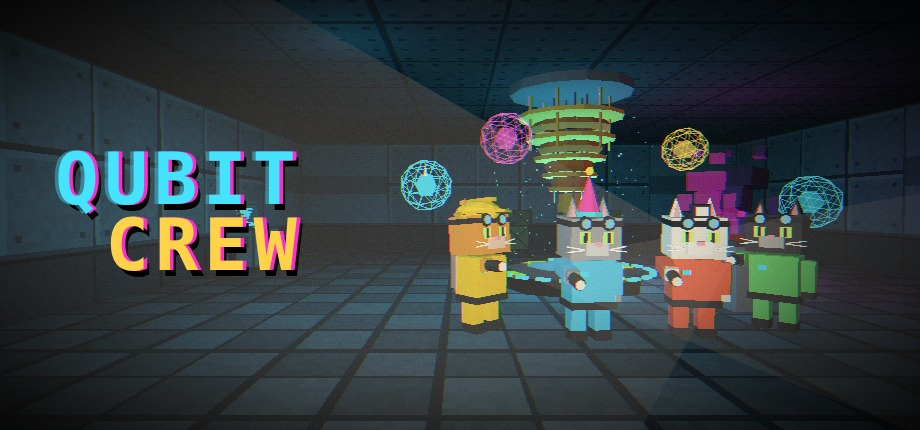

# Qubit Crew



**Kooperativní 3D hra s kvantovou tématikou pro 1-6 hráčů** - posádka laboratorních koček zachraňuje
rozpadající se kvantový počítač. Hranatá retro grafika (nízké rozlišení, dithering, chvění vrcholů jako
na starých konzolích), online multiplayer přes Steam, LAN přes IP, 20 DLC sektorů a vše připravené
pro vydání na Steamu.

> **Návod, jak hru dostat na Steam (včetně cen hry a DLC): [docs/NAVOD_STEAM.md](docs/NAVOD_STEAM.md)**

## O co ve hře jde

- **Qubity jsou v superpozici** - blikají na 2-3 místech zároveň. Baterka je měřicí přístroj: posviť
  na qubit a ten zkolabuje na **jedno** z míst (náhodně - možná přímo před tebou, možná za zdí).
- Qubity **odnes do jádra** (kryostatu uprostřed mapy). Každé doručení vrací jádru koherenci.
- Koherence pořád klesá. Splň kvótu, zmáčkni **RUN** na jádře a přežij další směnu. Na nule je konec.
- **Číhači** se hýbou jen, když se na ně nikdo nedívá - drž je ve světle, zmrznou a nakonec zmizí.
  **Mraky dekoherence** procházejí zdmi a vysávají jádro. **Roztoči** kradou nesené qubity.
- **Kvantové tunelování** (Q / pravé tlačítko) tě přenese skrz zeď. **Ping** (G) označí místo posádce.
- Zlaté qubity mají dvojnásobnou hodnotu, růžové jsou **provázané** - doruč oba do 20 s pro bonus.
- Mezi směnami tým nakupuje vylepšení (širší paprsek, více kapes, oprava chyb...).
- Každá směna je nová **procedurálně generovaná** mapa.

## 20 DLC sektorů

Každé DLC přidává sektor s vlastním kvantovým pravidlem a čepici pro kočku:

| # | Sektor | Pravidlo |
|---|---|---|
| 01 | Deep Freeze | supravodivá podlaha, nulové tření |
| 02 | Laser Grid | místnostmi jezdí fotonové paprsky, přeskakuj je |
| 03 | Ion Storm | rotující pole pasti strká celou posádku |
| 04 | Entanglement Station | hráči si náhodně prohazují místa (sólo: s anomálií) |
| 05 | Many-Worlds Wing | dvě reality se střídají, zdi mizí a objevují se |
| 06 | Tunnel Junction | žádné dveře, místnosti jen přes tunelování |
| 07 | Zero-Point Chamber | nízká gravitace, virtuální částice ve vzduchu |
| 08 | Uncertainty Ward | nepozorované anomálie přeskakují, mapa se chvěje |
| 09 | Annealer Furnace | po podlaze se valí vlny žáru |
| 10 | Qubit Foundry | každá chodba je dopravníkový pás |
| 11 | Schrödinger's Menagerie | krabice: qubit, nebo anomálie? |
| 12 | Condensate Pool | pole kondenzátu zpomalují čas |
| 13 | Topological Maze | mapa je torus, okraje vedou na druhou stranu |
| 14 | Error Correction Center | bit flip obrátí ovládání, phase flip barvy i myš |
| 15 | Dark Fiber | žádné lampy, neviditelní zloději, svítící vlákno domů |
| 16 | Time Crystal Vault | ozvěna z doby před 6 s svítí a mrazí anomálie |
| 17 | Quantum Dot Disco | světla do rytmu a výpadky při dropu |
| 18 | Neutrino Tank | zatopené haly, anomálie procházejí zdmi |
| 19 | Gravity Wave Lab | gravitační vlny přejíždějí mapu a odhazují hráče |
| 20 | Singularity Core | černá díra obíhá sektorem a přitahuje vše |

Technicky: obsah DLC je součástí hry a odemyká se podle vlastnictví na Steamu (`BIsDlcInstalled`).
V multiplayeru stačí, aby sektor vlastnil hostitel.

## Spuštění

Potřebuješ [Node.js 22 LTS](https://nodejs.org).

```bash
npm install
```

```bash
npm start
```

| Příkaz | Co dělá |
|---|---|
| `npm start` | hra v okně (Electron); bez spuštěného Steamu běží offline (sólo + LAN) |
| `npm run dev` | hra v prohlížeči na http://localhost:5173 (`?dlc=all` odemkne DLC - jen ve vývoji) |
| `npm test` | bot odehraje směny, projde všech 24 sektorů a otestuje multiplayer |
| `npm run dist:win` | hotová Windows verze do `dist/win-unpacked` |
| `npm run steam:stage` | připraví build a skript pro nahrání na Steam |
| `npm run store:assets` | znovu vyrenderuje obrázky pro obchod do `store-assets/` |
| `npm run server` | samostatný LAN relay server (port 7777) |

## Ovládání

WASD pohyb · Shift sprint · mezerník skok · myš rozhlížení · F baterka · Q / pravé tlačítko tunel ·
E použít · G / kolečko ping · Enter nebo T chat · Esc pauza

## Struktura projektu

```
src/            herní kód (bundluje se do app/game.js)
  main.js       spojení všeho dohromady, menu, Steam/LAN/sólo, achievementy
  game.js       klient: vykreslování světa, hráč, synchronizace
  host.js       autoritativní simulace hostitele (qubity, anomálie, koherence, směny, obchod)
  mutators.js   pravidla 20 DLC sektorů
  level.js      generátor map, kolize, viditelnost, hledání cesty
  models.js     všechny 3D modely (kočky, anomálie, qubity, jádro) - z kódu, bez externích souborů
  gfx.js        renderer + retro post-processing (dithering, chvění, glitch)
  net.js        síť: LAN (WebSocket relay) a Steam P2P
  ui.js         menu, lobby, HUD, minimapa, chat
  audio.js      zvuky syntetizované za běhu (žádné zvukové soubory)
  i18n.js       texty EN + CS
electron/       desktopová aplikace + napojení na Steam (steamworks.js)
server/relay.js LAN relay
steam/          skripty pro SteamPipe
store-assets/   hotové obrázky pro Steam (hra, 20 DLC, achievementy)
docs/           návod pro Steam a texty do obchodu
tools/          build, testy, generátory obrázků a textů
```

Všechna grafika, modely a zvuky vznikají v kódu - hra nepoužívá žádné cizí assety, takže s licencemi
není problém. Použité knihovny (three.js, ws, steamworks.js - MIT) jsou v `THIRD_PARTY_NOTICES.txt`,
který se přibaluje ke hře.

---

*English:* Qubit Crew is a co-op (1-6 players) retro low-poly 3D game about lab cats measuring qubits out of
superposition with flashlights. Steam online co-op (lobbies + P2P), LAN by IP, 20 DLC sectors with unique
rules, Electron + steamworks.js. Run `npm install && npm start`. Steam release guide (Czech):
[docs/NAVOD_STEAM.md](docs/NAVOD_STEAM.md); store texts: [docs/STORE_TEXTY.md](docs/STORE_TEXTY.md).
